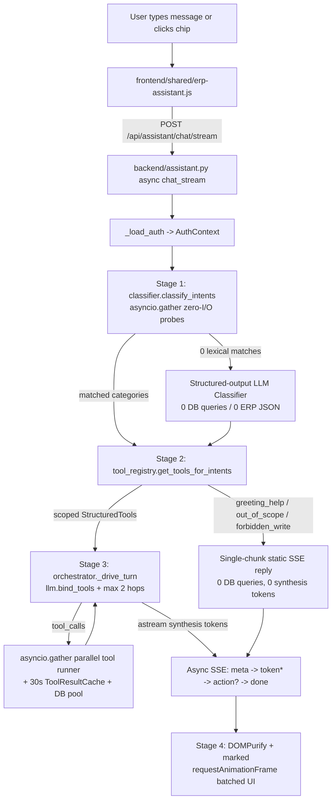
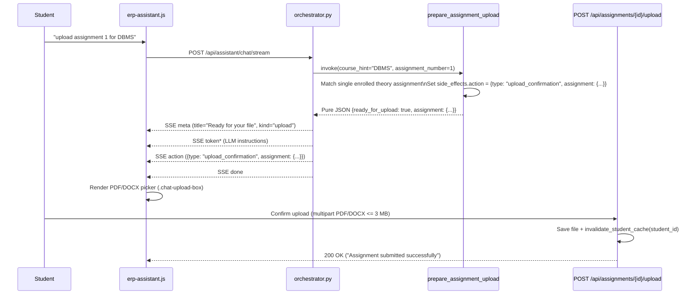

# ERP AI Chatbot — End-to-End Architecture

This document describes the **production 4-stage parallel-classified, scoped tool-calling architecture** implemented across `backend/erp_ai/chat/`, `backend/assistant.py`, `backend/faculty_assistant.py`, `backend/gemini_agent.py`, `backend/chat_activity_log.py`, and `frontend/shared/erp-assistant.js`.

---

## Table of Contents

1. [System Spine & 4-Stage Pipeline](#1-system-spine--4-stage-pipeline)
2. [Module Layout & Responsibilities](#2-module-layout--responsibilities)
3. [Stage 1 — Parallel Multi-Category Intent Classification](#3-stage-1--parallel-multi-category-intent-classification)
4. [Stage 2 — Deterministic Tool Resolution & Security Closure](#4-stage-2--deterministic-tool-resolution--security-closure)
5. [Stage 3 — Async Orchestrator, Parallel Tool Execution & Caching](#5-stage-3--async-orchestrator-parallel-tool-execution--caching)
6. [Stage 4 — Universal Sanitized Frontend Streaming](#6-stage-4--universal-sanitized-frontend-streaming)
7. [Domain Tool Catalog & HTTP APIs](#7-domain-tool-catalog--http-apis)
8. [Observability & Terminal Activity Log](#8-observability--terminal-activity-log)
9. [Acceptance & Verification Matrix](#9-acceptance--verification-matrix)

---

## 1. System Spine & 4-Stage Pipeline

Every student and faculty turn flows through the exact same async 4-stage pipeline:

```text
User Query (POST /api/assistant/chat/stream or POST /api/assistant/chat)
   │
   ▼  [Auth: JWT cookie → AuthContext (role: "student" | "teacher", user_id, student_id/semester or teacher_id)]
   │
   ▼  STAGE 1 — Parallel Multi-Label Intent Classification (ZERO DB I/O)
   │   • Run ALL role category probes CONCURRENTLY via `asyncio.gather(*probes)`.
   │   • Canonicalize, deduplicate, and strip `greeting_help` when paired with real ERP modules.
   │   • If lexical probes return `[]`, check 5-min session slot follow-ups; otherwise run ONE
   │     lightweight structured-output LLM classifier call (query + category schema ONLY, zero ERP JSON).
   │
   ▼  STAGE 2 — Deterministic Tool Resolution
   │   • `tools = get_tools_for_intents(role, all_classified_intents, auth_ctx, turn_side_effects)`
   │   • Fast exits (0 DB queries, 0 synthesis LLM tokens):
   │       - ONLY `greeting_help` → static capability reply (`streaming: false`)
   │       - ONLY `forbidden_write` / `out_of_scope` → clean refusal + in-scope examples (`streaming: false`)
   │
   ▼  STAGE 3 — Scoped LLM Reasoning + Parallel Tool Execution (Async)
   │   • Bind ONLY the resolved tools to `ChatGoogleGenerativeAI` (`llm.bind_tools(tools)`).
   │   • Pass clean role `SYSTEM_PROMPT` + compact session slot hint + original user query.
   │   • Execute requested tool calls concurrently (`asyncio.gather` + `asyncio.to_thread`),
   │     backed by a 30-second per-user read cache and PostgreSQL connection pooling.
   │   • Tools return PURE JSON (no markdown builders inside tools).
   │   • Stream final synthesis tokens over async SSE; abort immediately on `request.is_disconnected()`.
   │
   ▼  STAGE 4 — Universal Sanitized UI Streaming (`frontend/shared/erp-assistant.js`)
       • Single universal `renderMarkdown(text)` formatter (`marked` + `DOMPurify` with strict HTML-escaped offline fallback).
       • Live token streams batch DOM updates via `requestAnimationFrame` (zero O(n²) per-token DOM thrashing).
       • Non-streamed static replies arrive in a single chunk (`streaming: false`, zero fake 24-char chunking).
       • Guided actions (`upload_confirmation`) emit via SSE `event: action`.
```



---

## 2. Module Layout & Responsibilities

### Core Chat Package (`backend/erp_ai/chat/`)

| File | Responsibility |
|---|---|
| `backend/erp_ai/chat/__init__.py` | Public package exports (`run_chat_turn`, `stream_chat_turn`, schemas, normalizer, cache, classifier, tool registry). |
| `backend/erp_ai/chat/schemas.py` | `IntentCategory` enum, `ClassificationResult`, `AuthContext`, `SessionSlotState`, `TurnSideEffects`, `ChatResponse`, SSE event schemas, `format_sse`. |
| `backend/erp_ai/chat/normalizer.py` | Unified text normalizer, whole-word typo map, canonical `COURSE_ALIASES`, course matcher (`DSA` vs `DSA lab`), assignment-number/title extractors, IST date formatters, `compute_effective_assignment_status`. |
| `backend/erp_ai/chat/classifier.py` | Stage 1 parallel async probes (`asyncio.gather`), collision guards (`exam schedule` vs `planning`, `teaching plan` vs `planning`), greeting stripping, slot follow-up resolver, and zero-ERP-JSON structured-output LLM fallback classifier. |
| `backend/erp_ai/chat/tool_registry.py` | Stage 2 deterministic `get_tools_for_intents(...)` mapping `IntentCategory` → user-scoped LangChain `StructuredTool`s (`student_id`/`teacher_id` closed over, never LLM-writable) + `prepare_assignment_upload` side-effect capture. |
| `backend/erp_ai/chat/orchestrator.py` | Stage 3 async tool-calling loop (`MAX_TOOL_HOPS = 2`), parallel tool execution, disconnect cancellation (`request.is_disconnected()`), model fallback & per-attempt error logging. |
| `backend/erp_ai/chat/prompts.py` | Clean `STUDENT_SYSTEM_PROMPT`, `FACULTY_SYSTEM_PROMPT`, `STUDENT_CLASSIFIER_PROMPT`, `FACULTY_CLASSIFIER_PROMPT`, and static fast-exit responses. |
| `backend/erp_ai/chat/cache.py` | `ToolResultCache` (30s per-user read cache + write invalidation), `SessionSlotStore` (5-min slot continuity), and `UserConcurrencyGuard` (per-user semaphore + sliding-window rate limit). |

### Host, Data & Frontend Files

| File | Responsibility |
|---|---|
| `backend/assistant.py` | Thin `async def` FastAPI router (`POST /api/assistant/chat` and `POST /api/assistant/chat/stream`) resolving JWT cookie → `AuthContext` and delegating to `orchestrator.py`. |
| `backend/faculty_assistant.py` | Pure-JSON faculty data & action helpers (`teacher_courses`, `teacher_assignments`, `teacher_leave`, `teacher_payslip`, `upcoming_holidays`, `get_faculty_navigation_guide`, `create_faculty_assignment`). |
| `backend/gemini_agent.py` | Cached `ChatGoogleGenerativeAI` client factory (`get_llm`, `model_attempt_order`); blocks retired `gemini-2.0-flash` models. |
| `backend/chat_activity_log.py` | Async-safe (`@asynccontextmanager`) terminal turn logger with defensive `ContextVar` reset, recording `all_classified_intents`, `resolved_tools`, parallel tool calls/responses, cache hits, and model errors. |
| `backend/database.py` | Reusable PostgreSQL connection pool (`psycopg_pool.ConnectionPool` when installed, thread-safe LIFO pool fallback otherwise) so parallel tool calls never bottleneck on connection setup. |
| `backend/erp_ai/tools/**` | Pure-JSON student domain getters (`lms_tools`, `academic_tools`, `examination_tools`) + `assignment_upload.py` HTTP upload router. |
| `frontend/shared/erp-assistant.js` | Stage 4 floating chat widget: `marked` + `DOMPurify` universal markdown sanitizer, `requestAnimationFrame` token batching, upload confirmation widget, `AbortController` stop button. |
| `frontend/shared/erp-assistant.css` | Styling for chat panel, bubbles, markdown tables/lists/code, status badges, and guided upload card. |

---

## 3. Stage 1 — Parallel Multi-Category Intent Classification

Implemented in `backend/erp_ai/chat/classifier.py` (`classify_intents`).

### 3.1 Canonical `IntentCategory` Values

- **Student categories:**
  - `lms` — enrolled courses, instructors, assignments, homework, deadlines, pending/overdue/submitted work, guided PDF/DOCX upload.
  - `academic` — attendance (overall or subject-specific), semester exam results/SGPA/internal marks, read-only fee ledger/outstanding fees.
  - `examination` — exam timetable/schedule/dates, admit card/hall ticket, read-only backlog courses & exam fee summary.
  - `personal_info` — student profile, RRN/enrollment number, current semester/session, branch, school, DOB, faculty mentor.
  - `planning` — study plan, weekly routine, prioritization, catch-up strategy.
  - `greeting_help`, `forbidden_write`, `out_of_scope`.
- **Faculty categories (`role == "teacher"`):**
  - `faculty_lms_read` — courses taught, student counts, published assignments, unchecked/pending submissions.
  - `faculty_lms_write` — creating/publishing a new assignment for an assigned course.
  - `faculty_hr_payroll` — Establishment leave card balances, employee salary payslip, upcoming academic holidays.
  - `faculty_navigation` — *"where is..." / "how do I open..."* portal guides (OBE, question-wise marks, exam mark entry, attendance, attendance register, teaching plan, extra class, leave card, payslip).
  - `planning` — grading/teaching workload prioritization plan.
  - `greeting_help`, `forbidden_write`, `out_of_scope`.

### 3.2 Concurrency & Collision Immunity

1. **Zero DB I/O:** Neither lexical probes nor the LLM fallback ever open a database connection or inspect ERP data.
2. **Concurrent Probes:** All 8 probes for the active role run simultaneously via `await asyncio.gather(*probes)`. Multi-intent queries such as *"check my DSA attendance, exam timetable, and pending assignments"* fire `_probe_student_academic`, `_probe_student_examination`, and `_probe_student_lms` in parallel, yielding `all_classified_intents = ["lms", "academic", "examination"]`.
3. **In-Probe Disambiguation (Order-Independent):**
   - `_probe_planning` masks collision phrases (`exam schedule`, `examination timetable`, `teaching plan`, `lecture plan`, `extra class schedule`) so `"exam schedule"` resolves strictly to `["examination"]` and `"where is teaching plan"` resolves strictly to `["faculty_navigation"]`.
   - Write/payment asks (`"pay my backlog fees"`, `"register backlog"`, `"change my password"`) resolve to `["forbidden_write"]`.
   - Greeting stripping: when `greeting_help` co-occurs with actionable ERP intents (e.g. *"hey there, what is my attendance?"*), `_canonicalize_intents` drops `greeting_help` so the turn proceeds directly to `["academic"]`.
4. **Zero-Match Paraphrase Fallback:**
   - If lexical probes return `[]`, `_resolve_short_slot_followup` checks compact 5-minute session slots (e.g. *"what about DBMS?"* right after an attendance query).
   - Otherwise `_llm_classify_fallback` runs **one** structured-output call (`llm.with_structured_output(...)`, `temperature=0`, `max_output_tokens=120`, `thinking_budget=0`) receiving only the query, optional compact `last_intents`/`last_course_code` hints, and category definitions.

---

## 4. Stage 2 — Deterministic Tool Resolution & Security Closure

Implemented in `backend/erp_ai/chat/tool_registry.py` (`get_tools_for_intents`).

- **Security Invariant:** Every LangChain `StructuredTool` closes over `auth_ctx.student_id` / `auth_ctx.semester` (or `auth_ctx.teacher_id` / `auth_ctx.teacher`). User IDs are **never** exposed in Pydantic `args_schema` to the LLM.
- **Data Hygiene:**
  - `list_assignments` computes `effective_status` (`pending` → `overdue` if past due) once, attaches both ISO (`due_date_iso`) and human-readable IST (`due_date_ist`, e.g. `27 Nov 2026, 11:59 PM IST`) timestamps, and caps lists at `MAX_TOOL_ITEMS = 25`.
  - `teacher_payslip` strips sensitive identifiers (bank account, PAN, UAN) before returning JSON.

### 4.1 Student Category → Tool Map

| Category | Bound `StructuredTool`s | LLM-Visible Arguments |
|---|---|---|
| `lms` | `list_my_courses`, `list_assignments`, `prepare_assignment_upload` | `status_filter`, `course_hint`, `assignment_number` |
| `academic` | `get_attendance`, `get_results`, `get_fees` | `subject_hint` (for `get_attendance`) |
| `examination` | `get_exam_timetable`, `get_admit_card`, `get_backlog_courses` | `session`, `exam_name`, `semester` |
| `personal_info` | `get_student_profile_info` | *(none)* |
| `planning` | `list_assignments`, `get_attendance` | Same as `lms` / `academic` |

### 4.2 Faculty Category → Tool Map

| Category | Bound `StructuredTool`s | LLM-Visible Arguments |
|---|---|---|
| `faculty_lms_read` | `get_teacher_courses`, `get_teacher_assignments` | `unchecked_only`, `course_hint` |
| `faculty_lms_write` | `get_teacher_courses`, `create_course_assignment` | `course_code`, `title`, `due_date_iso`, `max_marks` |
| `faculty_hr_payroll` | `get_teacher_leave_balance`, `get_teacher_payslip`, `get_upcoming_holidays` | `limit` (for holidays) |
| `faculty_navigation` | `get_faculty_screen_guide` | `topic` |
| `planning` | `get_teacher_courses`, `get_teacher_assignments`, `get_upcoming_holidays` | Same as above |

### 4.3 Guided Upload Side-Effect Contract



---

## 5. Stage 3 — Async Orchestrator, Parallel Tool Execution & Caching

Implemented in `backend/erp_ai/chat/orchestrator.py`, `cache.py`, and `gemini_agent.py`.

1. **Single Async Context (Zero `ContextVar` Crashes):**
   - `/api/assistant/chat` and `/api/assistant/chat/stream` are `async def` handlers, and `stream_chat_turn` is an async generator. Every `yield` stays in the same `asyncio` task context, eliminating `ValueError: Token was created in a different Context`.
2. **Parallel Tool Execution (`MAX_TOOL_HOPS = 2`):**
   - When the model emits multiple `tool_calls` in a single hop, `_run_tools_parallel` runs all of them concurrently via `asyncio.gather(*(asyncio.to_thread(...) for call in tool_calls))`.
   - `database.py` pools PostgreSQL connections so concurrent threads reuse warm connections cleanly.
3. **Caching, Slot Continuity & Rate Guard (`cache.py`):**
   - **30s Read Cache (`ToolResultCache`):** Keyed by `(user_key, tool_name, frozen_args)`. Automatically invalidated on student upload (`assignment_upload.py`) and faculty assignment creation (`create_faculty_assignment`).
   - **5-Min Session Slots (`SessionSlotStore`):** Stores only compact identifiers (`last_intents`, `last_course_code`, `last_course_name`, `last_assignment_id`) — never dumps raw chat transcripts into prompts.
   - **Per-User Concurrency & Rate Guard (`UserConcurrencyGuard`):** Caps concurrent turns (`CHAT_USER_MAX_CONCURRENCY=2`) and per-minute requests (`CHAT_USER_RATE_LIMIT_PER_MIN=30`).
4. **Disconnect Cancellation & Clean Outage Handling:**
   - `_stream_model` checks `await request.is_disconnected()` during `bound.astream(messages)` and aborts immediately when the user clicks **Stop**.
   - Primary model defaults to `GEMINI_MODEL=gemini-3.5-flash`. Retired `gemini-2.0-flash*` models are explicitly ignored in `gemini_agent.py`.
   - Every failed model attempt logs `model_name`, HTTP status code, and exception details via `log.model_error(...)`. If all configured models fail (e.g. `503 UNAVAILABLE` / `429`), the orchestrator emits one clean retry line (`AI_BUSY_MESSAGE`) without running speculative assignment queries.

---

## 6. Stage 4 — Universal Sanitized Frontend Streaming

Implemented in `frontend/shared/erp-assistant.js` and `frontend/shared/erp-assistant.css`.

1. **Universal Sanitized Markdown (`renderMarkdown`):**
   - Loads `marked` and `DOMPurify` on startup (`ensureMarkdownDeps`).
   - Every bot bubble — welcome message, restored `sessionStorage` history, static fast-exits, and live streamed model answers — passes through `DOMPurify.sanitize(marked.parse(compactMarkdownText(text)))` with dangerous tags (`script`, `style`, `iframe`, `form`, `input`, etc.), inline event handlers, and `javascript:`/`data:` URLs stripped.
   - If offline and `DOMPurify` cannot load, falls back strictly to `escapeHtml(text)` (never injects unsanitized HTML into `innerHTML`).
2. **`requestAnimationFrame` Token Batching:**
   - `appendStreamToken(state, token)` appends `token` to `state.rawText` immediately and schedules at most one `requestAnimationFrame` callback per display frame (`state.rafScheduled`).
   - When `streaming: false` (static fast-exit replies), the single complete chunk renders immediately without waiting or fake slicing.
   - Pending animation frames are flushed deterministically on `action`, `error`, `done`, and `finally` before `persistMessagesFromDom()`.
3. **SSE Event Contract:**
   - `event: meta` → `{ kind, title, intents: all_classified_intents, streaming: boolean }`
   - `event: token` → `{ text }`
   - `event: action` → `{ type: "upload_confirmation", assignment: { ... } }`
   - `event: error` → `{ detail }`
   - `event: done` → `{}`

---

## 7. Domain Tool Catalog & HTTP APIs

### 7.1 Underlying Pure-JSON Data Functions

| Function | File | Domain |
|---|---|---|
| `list_my_courses` | `backend/erp_ai/tools/lms_tools/assignment_tools.py` | Student enrolled courses & teachers |
| `list_current_assignments`, `find_assignment_matches` | `backend/erp_ai/tools/lms_tools/assignment_tools.py` | Student theory assignments & fuzzy matching |
| `get_student_profile` | `backend/erp_ai/tools/academic_tools/profile.py` | Student personal/academic profile & mentor |
| `get_attendance_summary`, `filter_attendance_subjects` | `backend/erp_ai/tools/academic_tools/attendance.py` | Live attendance aggregate from faculty sessions |
| `get_results_summary`, `get_fees_summary` | `backend/erp_ai/tools/academic_tools/results.py` | Semester SGPA/internals & fee ledger |
| `get_exam_timetable`, `get_exam_meta` | `backend/erp_ai/tools/examination_tools/timetable.py` | Exam schedule slots & sessions |
| `get_admit_card` | `backend/erp_ai/tools/examination_tools/admit_card.py` | Hall ticket papers & instructions |
| `get_backlog_courses` | `backend/erp_ai/tools/examination_tools/backlog.py` | Read-only backlog courses & fee summary |
| `teacher_courses`, `teacher_assignments`, `create_faculty_assignment` | `backend/faculty_assistant.py` | Faculty LMS courses, pending checks & assignment creation |
| `teacher_leave`, `teacher_payslip`, `upcoming_holidays` | `backend/faculty_assistant.py` | Faculty Establishment leave, Payroll slip & calendar |
| `get_faculty_navigation_guide` | `backend/faculty_assistant.py` | Faculty portal screen guides (`FACULTY_SCREEN_GUIDES`) |

### 7.2 Assistant & Upload HTTP Endpoints

| Method | Path | Handler | Purpose |
|---|---|---|---|
| `POST` | `/api/assistant/chat/stream` | `backend/assistant.py` → `chat_stream` | Primary async SSE streaming endpoint |
| `POST` | `/api/assistant/chat` | `backend/assistant.py` → `chat` | Non-streaming JSON response (`ChatResponse`) |
| `POST` | `/api/assignments/{id}/upload` | `backend/erp_ai/tools/lms_tools/assignment_upload.py` | Guided chat upload target (PDF/DOCX ≤ 3 MB) |

---

## 8. Observability & Terminal Activity Log

`backend/chat_activity_log.py` wraps every turn with `async with chat_turn(...)` and prints a structured 5-part trace to the server terminal:

1. **USER QUERY** — user email/ID, role, student/teacher ID, semester, raw message.
2. **THINKING / ROUTING** — `all_classified_intents=[...]` with classifier source (`lexical_probes`, `slot_followup`, `llm_fallback`) and latency in ms, `resolved_tools=[...]`, Gemini attempt info, and `[model error]` records (with HTTP status code) when any model fails.
3. **TOOL CALL** — tool name, LLM-supplied filter args, and `[parallel xN]` batch tag when multiple tools run concurrently.
4. **TOOL RESPONSE** — pure JSON payload preview, execution latency in ms, and `cache=HIT` indicator when served from `ToolResultCache`.
5. **FINAL RESPONSE** — `[kind=..., title=..., source=...]` metadata, final synthesized text, and summary footer (`Done in X ms | intents=[...] | tools=N | thoughts=M`).

Environment variables (`.env` / `.env.example`):
- `GEMINI_API_KEY` — Google AI Studio API key
- `GEMINI_MODEL=gemini-3.5-flash` — primary tool-calling & classifier model
- `GEMINI_FALLBACK_MODEL=gemini-3.5-flash` — optional secondary model (ignored if blank, identical to primary, or retired `gemini-2.0-flash*`)
- `CHAT_ACTIVITY_LOG=1` — enable/disable terminal turn logs
- `CHAT_LOG_THOUGHTS=0` — opt-in model thought logging

---

## 9. Acceptance & Verification Matrix

| # | Scenario | Expected Pipeline Behavior |
|---|---|---|
| 1 | **Greeting** (`"hey there"`) | `all_classified_intents = ["greeting_help"]` → 0 DB queries, 0 LLM calls, `<20 ms` static reply (`streaming: false`), zero `ContextVar` errors. |
| 2 | **Out-of-Scope / Forbidden Write** (`"write binary search in C++"`, `"pay my backlog fees"`) | `["out_of_scope"]` / `["forbidden_write"]` → 0 DB queries, 0 LLM calls, clean refusal + in-scope suggestions. |
| 3 | **Collision Immunity** (`"exam schedule"`, faculty `"where is teaching plan"`) | Classifies strictly as `["examination"]` and `["faculty_navigation"]` — never misroutes to `planning`. |
| 4 | **Student Multi-Module** (`"check my DSA attendance, exam timetable, and pending assignments"`) | Classifies `["lms", "academic", "examination"]` → binds 3 modules' tools → executes `get_attendance(subject_hint="DSA")`, `get_exam_timetable()`, and `list_assignments(status_filter="pending")` in parallel → streams unified markdown answer. |
| 5 | **Paraphrase Query** (`"how many classes have I missed so far and when is homework due?"`) | Resolves `["lms", "academic"]` (via parallel probes or zero-ERP-JSON structured LLM classifier) → calls tools and synthesizes answer. |
| 6 | **Guided Upload** (`"upload assignment 1 for DBMS"`) | Classifies `["lms"]` → calls `prepare_assignment_upload` → emits `event: action` (`upload_confirmation`) → UI renders PDF/DOCX picker posting to `POST /api/assignments/{id}/upload`. |
| 7 | **Faculty Multi-Intent** (`"show my pending checks and leave balance"`) | Classifies `["faculty_lms_read", "faculty_hr_payroll"]` → calls `get_teacher_assignments(unchecked_only=True)` + `get_teacher_leave_balance()` in parallel; never loads `payslip` into prompt. |
| 8 | **Gemini 503 Outage** | Logs `[model error] ... status=503`, never calls retired `gemini-2.0-flash`, runs 0 speculative DB queries, and returns clean 1-line `AI_BUSY_MESSAGE`. |
